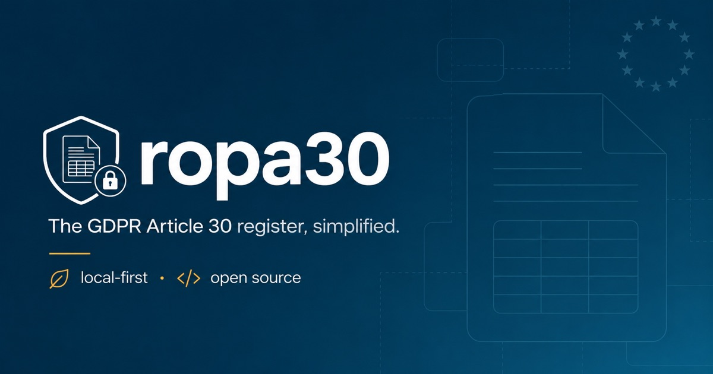

# ropa30

> Il registro dei trattamenti GDPR, semplice.

**ropa30** è un'applicazione web gratuita e open source che aiuta piccole imprese,
liberi professionisti, associazioni e Responsabili della Protezione dei Dati (DPO)
a tenere il proprio **Registro delle Attività di Trattamento** previsto
dall'articolo 30 del Regolamento UE 2016/679 (GDPR).

È progettata per essere radicalmente semplice — utilizzabile anche da chi non ha
competenze informatiche — pur restando rigorosa dal punto di vista giuridico
e della sicurezza.

🇬🇧 [Read this page in English](README.md)

> **Policy del repository.** Lo sviluppo primario avviene su **Codeberg**
> ([codeberg.org/nicfab/ropa30](https://codeberg.org/nicfab/ropa30)).
> Questo repository GitHub è un mirror in sola lettura, fornito per favorire la
> reperibilità. Apri issue e pull request su Codeberg.

---

## Documentazione

📖 **Guida utente (IT/EN):** [codeberg.org/nicfab/ropa30/wiki](https://codeberg.org/nicfab/ropa30/wiki)

---

## Perché ropa30?

La maggior parte degli strumenti per il registro dei trattamenti rientra in una
di queste tre categorie:

- **SaaS proprietari a pagamento** (OneTrust, Openli, Captain Compliance),
- **Applicazioni open source complesse** che richiedono Linux, Docker, Apache,
  MySQL o competenze equivalenti per essere installate e mantenute,
- **Modelli statici in foglio elettronico** (Excel, Word) facili da sbagliare
  e che diventano rapidamente obsoleti.

**ropa30 sceglie una strada diversa**: è un'applicazione web _local-first_.
La apri nel browser e funziona. Nessun server, nessun database da configurare,
nessun account da creare, nessun cloud a cui fidarsi.

---

## Principi cardine

- **🔒 Privacy by design, non per promessa.** I dati del tuo registro non
  lasciano mai il tuo dispositivo. Nessuna telemetria, nessuno script di
  tracciamento, nessuna richiesta a terze parti, nessuna sincronizzazione cloud.
  Tutto è memorizzato localmente nel browser tramite IndexedDB.

- **🌍 Open source — AGPL-3.0-or-later.** Libero di usare, studiare, modificare,
  condividere. Qualsiasi opera derivata — compresi servizi web costruiti su
  ropa30 — deve restare open source. Stessa filosofia di Nextcloud, Mastodon,
  Bitwarden.

- **🧭 Allineato agli standard.** Il modello dati segue l'art. 30 GDPR campo per
  campo. Le date sono in formato ISO 8601 e il catalogo dei modelli usa i
  termini W3C DCAT / Dublin Core per le versioni (`version`, `issued`,
  `modified`). I dati sono esportabili in JSON e il loro formato è documentato
  da una specifica dei dati pubblica (JSON Schema, versione 1.0): vedi
  [`public/schema/v1`](public/schema/v1/README.md).

- **🌱 Semplicità "Steve Jobs".** Nessuna installazione, nessun account,
  nessuna configurazione oltre a una breve impostazione iniziale dei dati del
  titolare. I modelli pronti all'uso permettono di creare un trattamento
  completo in pochi clic, e per ogni campo sono disponibili indicazioni GDPR
  in linguaggio chiaro.

- **🇪🇺 Infrastruttura europea e sovrana.** Lo sviluppo principale avviene su
  [Codeberg](https://codeberg.org/nicfab/ropa30), un'istanza Forgejo non-profit
  con sede a Berlino. Il mirror su GitHub esiste solo per visibilità.

---

## Funzionalità

### Disponibili

- Registri delle attività di trattamento del titolare (art. 30, par. 1) e del responsabile (art. 30, par. 2)
- Interfaccia e modello dati bilingui (italiano / inglese)
- Scheda dell'organizzazione con i dati del titolare o del responsabile, del suo rappresentante nell'Unione (art. 27) e del DPO
- Editor a moduli per ogni trattamento
- Indicazioni GDPR contestuali per ogni campo dell'editor e per ogni sezione della scheda dell'organizzazione
- Catalogo di 35 modelli pronti all'uso (12 generali, 23 per studi legali), da adattare alla propria organizzazione, con versioni e avviso di aggiornamento
- Unità organizzative, con filtro nell'elenco dei trattamenti e negli export
- Esportazione in PDF, XLSX e ODS
- Backup e ripristino completi in JSON, con cifratura facoltativa tramite password (AES-256)
- Local-first: tutti i dati restano nel browser (IndexedDB), senza backend né connessioni esterne
- Progressive Web App installabile e utilizzabile offline
- Tema scuro, che segue l'impostazione del sistema operativo
- Contitolari per ciascun trattamento (art. 30, par. 1, lett. a) e, nel registro del responsabile, titolari per conto dei quali si agisce, con rappresentante e DPO ove applicabili (art. 30, par. 2, lett. a)
- Accessibilità verso WCAG 2.2 AA (nomi accessibili, contrasti, focus da tastiera nelle finestre, dimensione delle aree cliccabili), verificata da test automatici, da un audit axe-core delle schermate principali e dall'uso con la sola tastiera: vedi la [dichiarazione di accessibilità](https://codeberg.org/nicfab/ropa30/wiki/Accessibilita)
- Specifica dei dati pubblica, versione 1.0 (JSON Schema 2020-12), con il riferimento GDPR di ogni campo: [`public/schema/v1`](public/schema/v1/README.md)

### Roadmap

- [ ] Accessibilità: verifica con lettori di schermo (vedi i limiti noti nella [dichiarazione di accessibilità](https://codeberg.org/nicfab/ropa30/wiki/Accessibilita))

---

## Stato

✅ **Rilasciato e in sviluppo attivo.** Le release sono descritte nel [CHANGELOG](CHANGELOG.md); l'app è online su [ropa30.eu](https://ropa30.eu). Segui questo repository oppure [@nicfab@fosstodon.org](https://fosstodon.org/@nicfab) per gli aggiornamenti.

---

## Citazione e archiviazione

- **Citare ROPA30 (tutte le versioni):** DOI [10.5281/zenodo.21720639](https://doi.org/10.5281/zenodo.21720639). Questo DOI rimanda sempre all'ultima release; i metadati di citazione sono nel file [`CITATION.cff`](CITATION.cff).
- **Archivio del codice sorgente:** ROPA30 è conservato nell'[archivio Software Heritage](https://archive.softwareheritage.org/browse/origin/?origin_url=https://codeberg.org/nicfab/ropa30.git), che assegna a ogni versione un identificativo intrinseco e verificabile (SWHID, ISO/IEC 18670).
- DOI e SWHID specifici di ciascuna versione sono indicati, release per release, nel [CHANGELOG](CHANGELOG.md).

## Licenza

ropa30 è rilasciato sotto **GNU Affero General Public License v3.0 o successiva**
(AGPL-3.0-or-later). Vedi [LICENSE](LICENSE) per il testo completo.

---

## Autore

**Nicola Fabiano** — Avvocato, founding partner di
[Studio Legale Fabiano](https://fabiano.law), DPO certificato, ForHumanity
AI Act Certified Auditor, contributor CEN-CENELEC JTC 21 (prEN 18274),
membro dell'EDPB Support Pool of Experts.

- Blog: [nicfab.eu](https://nicfab.eu)
- Mastodon: [@nicfab@fosstodon.org](https://fosstodon.org/@nicfab)
- arXiv: [pagina autore](https://arxiv.org/a/fabiano_n_2.html)

---

## Contributi

I contributi sono benvenuti — segnalazioni di bug, richieste di funzionalità,
traduzioni e pull request. Vedi [CONTRIBUTING.md](docs/CONTRIBUTING.md) (in arrivo).

Per segnalazioni di sicurezza, fai riferimento a [SECURITY.md](docs/SECURITY.md)
(in arrivo) e **non** aprire issue pubbliche.
